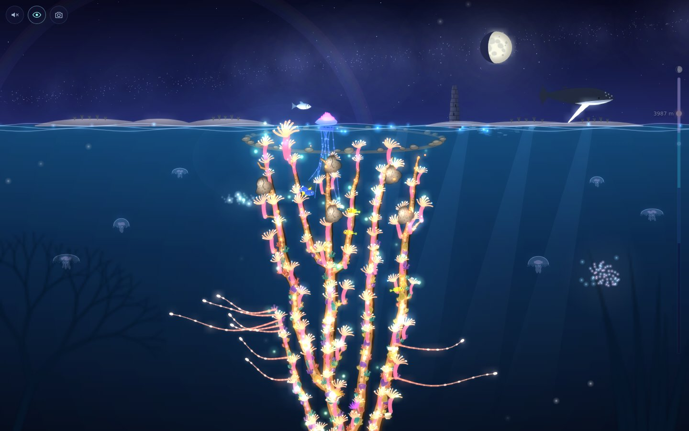
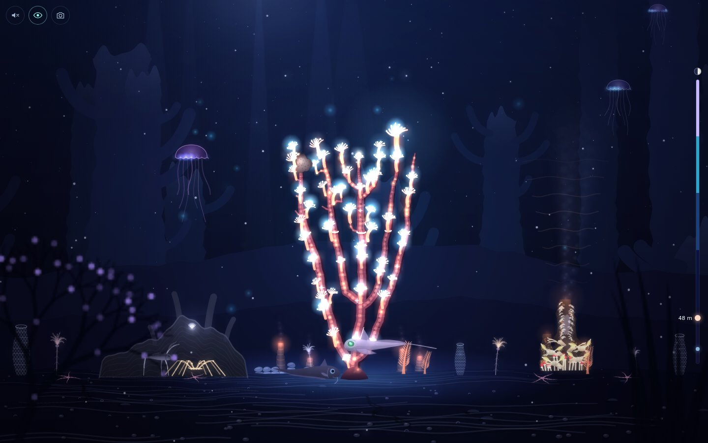
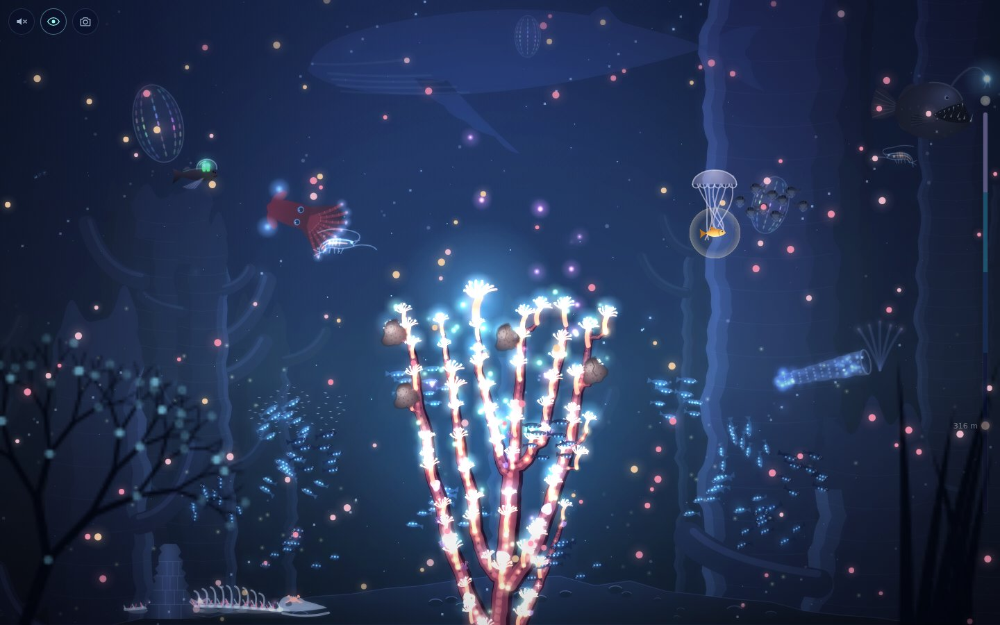
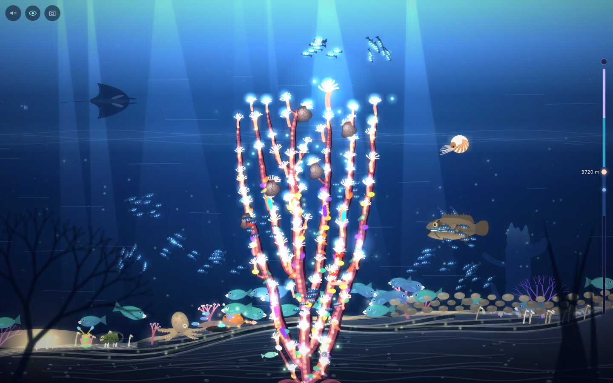
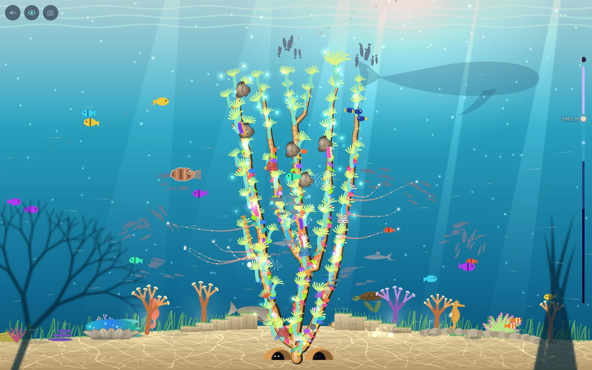
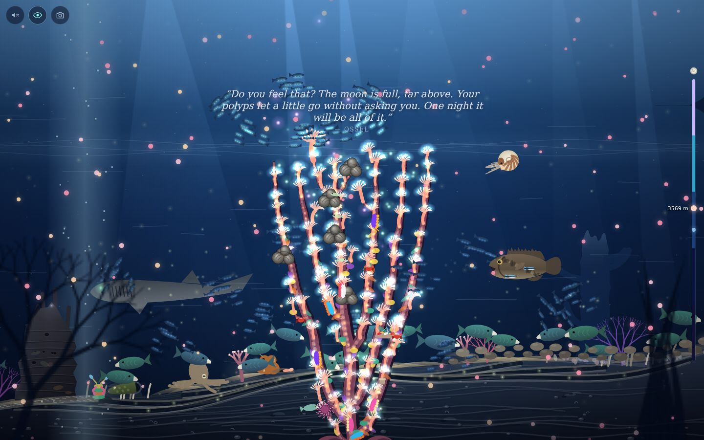
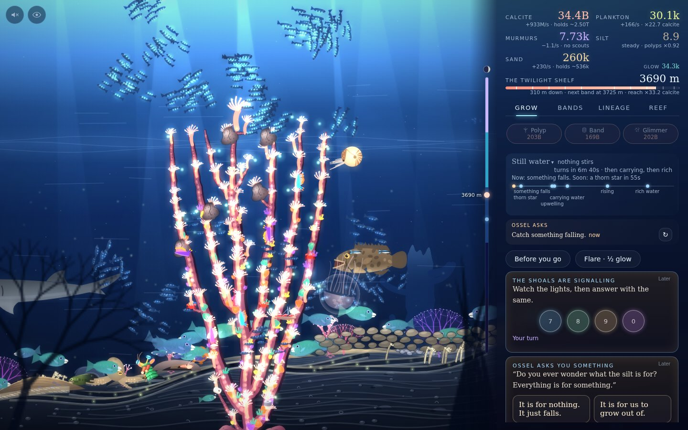
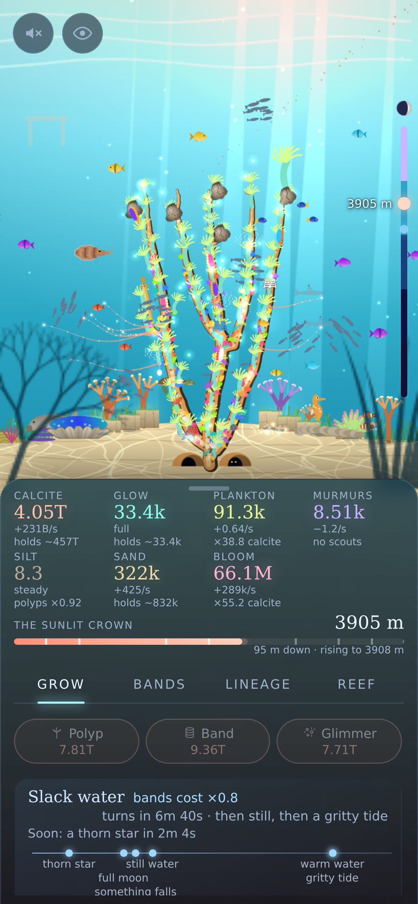

Note: This is a fully vibe coded game by Claude 5.5 with full creative freedom. I only really told it to create an incremental game, in canvas+html, in TypeScript served through nodejs with strip types. The rest is all generated by Claude.

# Corallum

**An incremental game about a coral reef climbing four thousand metres through a buried sea, to
spawn at the surface under the Spawning Moon.**



```
node src/server/server.ts      # then open http://localhost:8080/
```

Requires Node 24+. No dependencies and no build step: the TypeScript sources run as they are
(Node strips the types, and the server does the same for the browser).

## Note by me

This is a fully vibe coded project. Claude was told to create an incremental game with complete
artistic freedom in terms of gameplay, lore, graphics and UI.

The main restriction was that it would be a canvas game in the browser, served by nodejs using
strip types. I gave it the okay to add controls through html, although I regretted that later as
I think it harms the UI on a whole.

Claude Opus 5.5 wrote the rest on its own, only being prodded to continue with adding features,
improving gameplay, or graphics. I did not tell it what was wrong or what I didn't like.

Not yet, anyways.

The rest is AI written;

## The story

For four hundred years the **Long Silt** has fallen on the sea and buried every reef in it. In
this sea a reef is memory: each polyp lays down a band of stone holding what it saw, and the
buried reefs are drowned archives. You are the first polyp of a new reef, four thousand metres
down. Grow upward, read the bands of the dead reef-city **Thousandfold**, make a truce with the
**Rasp** that grind old stone to sand, and listen to **Ossel**, the last living polyp of a dead
wall, who remembers less than it thinks. On the night of the Spawning Moon you choose which
memories your children carry into a new sea.

## Five zones of the sea

| | |
|---|---|
|  |  |
| **The Silt Floor.** Glowing polyps, a hot vent, sea pigs and yeti crabs in the dark. | **The Midnight Water.** Lanternfish shoals to send out to feed, light and scout. |
|  |  |
| **The Twilight Shelf.** The Rasp, currents and silt, and creatures in trouble to free. | **The Sunlit Crown.** Colour returns: sunlight, seagrass, warm water to close up against. |

Under every full moon the other reefs spawn too, and the water fills with slow pink snow:



## How it plays

<p>
  
  
</p>

- **Grow, then choose.** Spend calcite on polyps, symbionts and stone; each zone adds a new
  stock and a new kind of decision: shoal jobs, the current, the truce terms, reef dialects.
- **Offline is exact.** Every store fills toward what the reef can hold, so time away is computed
  to the second, and a week away is worth the same as a month.
- **For those who watch.** Falling feasts, the shoals' light signal, intruders in every zone,
  riddles, lost shoals, drifting weed rafts, shooting stars to wish on, swells to ride.
  In view mode (the eye) the panel steps away; left alone, the camera drifts round the reef and
  now and then goes to one of its creatures, follows it a while and names it.
- **Every creature can be touched**, and most answer in their own way. A journal keeps a portrait
  of each one you have seen.
- **Moments ask how you meet things**: a dying brittle star, a cracked vent, weed on the crown.
  Each answer leaves a lasting mark on that reef.
- **Lesser spawnings** start over on a new seamount with Lineage: traits, boons, vows and hard
  seamounts that teach the whole line something.
- **It ends.** A real finale at the surface, then an epilogue garden and a chronicle of the
  line's endings.
- Desktop, phone portrait and phone landscape. Sound is procedural and off by default.

## Keys

| Key | | Key | |
|---|---|---|---|
| Space | sweep | 1–4 | tabs |
| P / B / G | buy | H | view mode (whole screen; wheel or pinch to zoom) |
| F | catch a feast | E | expedition |
| L | flare the lure | R | the rising |
| C | close up | S | ride a swell |
| K | break off old stone | W | wish |
| 7–0 | answer the signal | T | time-lapse |
| U | turn toward an upwelling | ? | the full list |

## Playing on a phone

Run `node src/server/server.ts --lan`; it prints an address on your network to open on the phone.
If a phone struggles, turn off "Full resolution" in the Reef tab. Served over HTTPS (or on
localhost), "Add to Home Screen" installs it to open full-screen like an app, and once opened it
plays with the server out of reach: the last visit's files are kept by the browser, and the reef
lives in its storage. Over plain `http://` on your network browsers allow neither, so there it
plays only while the server runs. On a phone, drag the panel's top (or its stocks) up
for more of the panel, down for more of the reef: dragged down once more it keeps just the
numbers, the tabs and the quick buys, gives the reef two thirds of the screen, and stays so.

Handy URL parameters: `?fps` shows a frame-rate readout, and `?bot=12000` jumps into a later zone
(the Twilight Shelf) without playing up to it (`?bot` games are not saved).

## Development

See `CLAUDE.md` for the commands (typecheck, tests, browser tests, the balance bot, screenshots)
and `docs/` for the plan, design, story (with its originality check) and economy.
